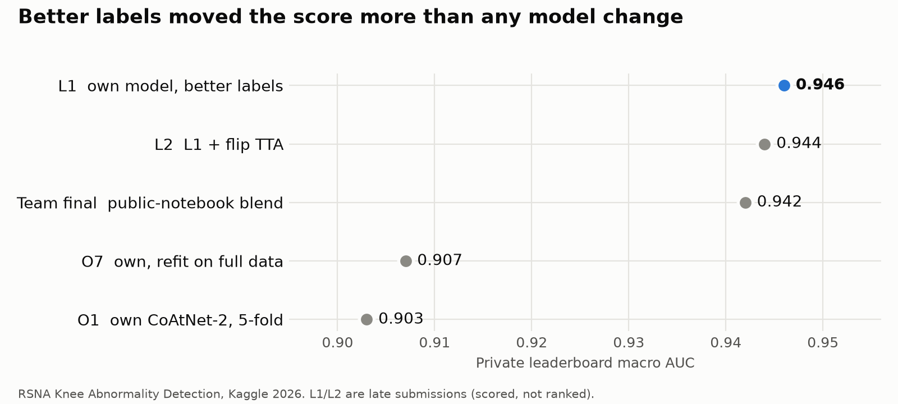
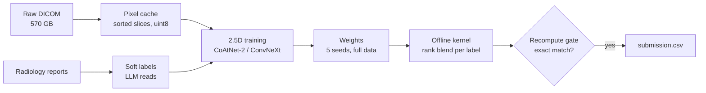

# RSNA Knee MRI Abnormality Detection

My own pipeline for the Kaggle competition
[RSNA Knee Abnormality Detection](https://www.kaggle.com/competitions/rsna-knee-abnormality-detection)
(Aug-Oct 2026): predict per-study probabilities for 12 knee-MRI findings (ACL, MCL,
medial/lateral meniscus, medial/lateral/patellofemoral OA, effusion, synovitis, Baker's
cyst, contusion, fracture) from raw DICOM. Metric: macro-averaged AUC. Code competition:
offline Kaggle notebooks, at most 9 h on one GPU, no internet.

Write-up with all 68 scored submissions, public vs private:
[kaggle.com/code/patimakornsrinamen/rsna-knee-68-submissions-public-vs-private](https://www.kaggle.com/code/patimakornsrinamen/rsna-knee-68-submissions-public-vs-private)

## Results

<picture>
  <source media="(prefers-color-scheme: dark)" srcset="assets/private-auc-dark.png">
  
</picture>

| Entry | What it is | Public | Private |
|---|---|---|---|
| Baseline (08-30) | DINOv2-S 2.5D @224, 3 folds, one LLM label set | 0.835 | - |
| Round 4 (09-04) | consensus of three LLM label sets, per-label attention head | 0.892 | - |
| Round 6 (09-14) | CoAtNet-2, stem frozen, warmup + cosine, lr 5e-5 | 0.912 | - |
| O1 (10-21) | own CoAtNet-2 arms, 5-fold models | 0.918 | 0.903 |
| O7 (10-22) | best own-only entry: three CoAtNet-2 arms, all refit on full data | 0.923 | 0.907 |
| Team final (10-22) | team Knee_Okay's selected entry (public-notebook blend) | 0.958 | 0.942 (rank 917 / 6,425) |
| **L1** (late, 10-27) | one own CoAtNet-2 arm, 5 seeds, on the 7th-place team's public labels | 0.956 | **0.946** |
| L2 (late, 10-27) | L1 + horizontal-flip TTA | 0.955 | 0.944 |
| L3 (late) | L1 + a ConvNeXt-Small arm on the same labels, no TTA | pending | pending |

Late submissions are scored but never enter the leaderboard; 0.946 private would have
placed about 124-161.

What moved the score, in order of size:

1. **Labels.** Only 58 training studies have expert labels; everything else is
   pseudo-labelled from the radiology reports. The same model went from 0.907 to 0.946
   private when trained on better report labels. No model change came close.
2. **Optimizer.** CoAtNet-2 scored 0.675 public with full fine-tuning and no warmup, and
   0.912 with the stem frozen, a one-epoch warmup, cosine decay and lr 5e-5.
3. **Full data.** Refitting each arm on all training studies (fixed epoch count, several
   seeds) instead of keeping 5 fold models: 0.903 -> 0.907 private.

Things that did not help when measured: bigger encoders, a stronger LLM teacher,
per-label pooling tuned on the 58 gold studies (it overfits them), per-label spatial
attention, unfreezing the whole backbone, and widening a blend with more arms.

## Pipeline



1. **Pixel cache** (`notebooks/cache/`): CPU Kaggle kernels turn 570 GB of DICOM into a
   uint8 cache. DICOM slice order is random, so slices are sorted by
   `ImagePositionPatient` projected on the `ImageOrientationPatient` normal. Recipe v5
   (`RECIPE_V5` in `src/preprocess.py`): 5 sequence slots (sagittal/coronal fluid and
   non-fluid, axial fluid), up to 18 slices each, 140 mm crop, 336 px.
2. **Labels** (`src/make_labels.py`, `src/pseudo_labels.py`, `src/label_variants.py`,
   `src/llm_reader.py`): soft labels per study from public LLM label sets and our own
   LLM reads of the reports. The 58 gold studies are a holdout only, never a selector.
3. **Training** (`notebooks/train/train_dinov2.py`): one script, many arms through the
   `ARMS` table (DINOv2-S, CoAtNet-2, ConvNeXt-Small). 2.5D: windows of adjacent slices
   go through a 2D backbone, then a per-label attention head (with a sequence-slot
   embedding) lets each of the 12 labels attend to the study's windows separately.
   Fold runs merge with `src/merge_fold_runs.py`, full-data seeds with
   `notebooks/train/merge_full.py`.
4. **Submission** (`notebooks/o1/build_o1.py`, `notebooks/fusion/fusion_submit.py`):
   builds an offline kernel from chosen arms, rank-blends them per label, and writes
   `submission.csv`. `notebooks/o1/recompute_o1.py` recomputes the blend from the
   kernel's per-arm outputs and must match exactly before anything is submitted.

## Layout

```
src/                 shared code: DICOM sorting, cache recipes, labels, model, AUC, blending
notebooks/cache/     pixel-cache build kernels and a shard checker
notebooks/train/     training script (ARMS table) and merge of full-data seeds
notebooks/infer/     single-family inference kernel
notebooks/fusion/    multi-arm fusion kernel
notebooks/o1/        builder, recompute gate and tests for own-arm submissions
notebooks/writeup/   builds the readable notebook edition
tools/               staging helper for local training, README chart (plot_results.py)
assets/              README images
docs/                EDA, methodology, label audit, pseudo-label notes, research notes, specs
```

Competition data, label CSVs and model weights are not in this repository. Some code
comments point to working notes that are not published (`docs/competitors*`,
`docs/team/`, `.plans/`); the code does not need them.

## Running it

Kaggle kernels are pushed with the CLI:

```
py -m kaggle kernels push -p notebooks/<name>
py -m kaggle kernels status <user>/<kernel-slug>
```

Kernels locate their inputs by marker file under `/kaggle/input`, so dataset mount
paths may change without breaking them. Request `machine_shape: NvidiaTeslaT4`; the
P100 pool is incompatible with Kaggle's current PyTorch build. Later rounds trained
locally on one RTX 5090 and uploaded the weights as Kaggle datasets.

`src/llm_reader.py` reads an API key from the environment or a file under `~/.config`;
no key is stored here.

## Credits and licences

Code in this repository: MIT (see `LICENSE`), except the files below.

- `notebooks/fusion/raptor_infer.py` and `notebooks/fusion/resgated_runner.py` (and the
  copies embedded in `fusion_submit.py`) reproduce public Kaggle notebook code under
  Apache-2.0; their headers name the sources. The Raptor CoAtNet recipe and weights
  are by dreaddevelopment (CC0-1.0).
- Late-round labels: [songqizhou/rsna-knee-llm-labels](https://www.kaggle.com/datasets/songqizhou/rsna-knee-llm-labels)
  (7th place, CC-BY-NC-SA-4.0). Weights trained on them are shared under the same
  licence on Kaggle; they are not included here.
- Earlier label sets: `stevenleehans/rsna-knee-llm-report-labels` (CC0),
  `pilkwang/rsna-knee-llm-labels` (CC0).
- Pixel-cache idea: stevenleehans's public notebook
  `rsna-knee-500gb-to-11gib-cpu-pixel-cache`.
- Competition data: RSNA, under the competition rules. It is not redistributed here.
